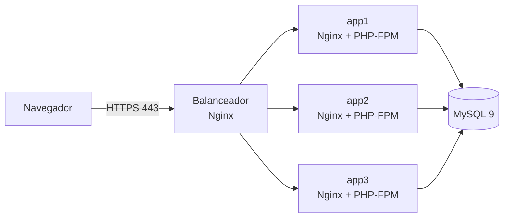

# Infraestructura de ManoVecina

Este documento describe los cinco apartados de infraestructura del proyecto: servidor de aplicaciones, servidor de base de datos, balanceo de cargas, configuración de dominio y certificados de seguridad. Cada apartado indica cómo está resuelto en el entorno local con Docker, cómo se traduce a producción y cómo demostrarlo con capturas.



## Puesta en marcha

Requisitos: Docker Desktop (con WSL2 en Windows).

```powershell
# 1. Certificado HTTPS (una sola vez)
powershell -ExecutionPolicy Bypass -File .\docker\certs\generar-certificado.ps1

# 2. Dominio local (PowerShell como administrador, una sola vez)
Add-Content -Path "$env:SystemRoot\System32\drivers\etc\hosts" -Value "127.0.0.1 manovecina.test"

# 3. Levantar todo
docker compose --env-file .env.docker up -d --build
docker compose --env-file .env.docker ps
```

Abrir `https://manovecina.test`. Si el puerto 80 o 443 está ocupado por otro programa, cierra ese programa antes de levantar el balanceador.

## 1. Servidor de aplicaciones

**Qué es.** El programa que ejecuta el código de la aplicación (PHP/Laravel) y responde a cada petición.

**Cómo está en ManoVecina.** Cada instancia es un contenedor construido con `Dockerfile.prod` en tres etapas (dependencias, compilación de Vue y imagen final). Dentro corren dos procesos administrados por `supervisord`:

| Pieza | Función | Archivo |
|-------|---------|---------|
| Nginx (puerto 8080) | Servidor web: entrega archivos y pasa las peticiones PHP al servidor de aplicaciones | `docker/nginx/app.conf` |
| PHP-FPM (puerto 9000) | Servidor de aplicaciones: ejecuta Laravel con un grupo de procesos | `docker/php/zz-manovecina.conf` |
| OPcache | Guarda el código PHP ya compilado en memoria | `docker/php/opcache.ini` |
| `entrypoint.sh` | Guarda la configuración en caché y arranca los procesos | `docker/entrypoint.sh` |

Parámetros principales de PHP-FPM: `pm = dynamic`, `pm.max_children = 10`, `pm.max_requests = 500`.

Se usa PHP-FPM con Nginx y no `php artisan serve` porque este último es un servidor de desarrollo que atiende una petición a la vez.

**Producción.** El servicio de la aplicación se despliega con el `Dockerfile` de la raíz (Railway). Para un servidor propio se usa `Dockerfile.prod`.

**Cómo demostrarlo.**
- `docker compose --env-file .env.docker ps`: las tres instancias aparecen como `healthy`.
- `curl.exe -sk -I https://manovecina.test` muestra `Server: nginx` y el encabezado `X-Instancia`.
- `docker compose --env-file .env.docker exec app1 php -v` muestra la versión de PHP.

## 2. Servidor de base de datos

**Qué es.** El programa que guarda y consulta los datos (usuarios, herramientas, préstamos).

**Cómo está en ManoVecina.** Un contenedor MySQL 9 independiente de la aplicación:

| Parámetro | Valor |
|-----------|-------|
| Imagen | `mysql:9` |
| Juego de caracteres | `utf8mb4` / `utf8mb4_unicode_ci` |
| Usuario de la aplicación | `manovecina` (sin permisos de administrador) |
| Persistencia | Volumen `db_datos`: los datos sobreviven aunque se recree el contenedor |
| Red | Solo la red interna; hacia afuera únicamente `127.0.0.1:3307` para conectar MySQL Workbench |
| Verificación de salud | `mysqladmin ping`; las instancias esperan a que esté lista |

Las tablas las crea el servicio `migraciones`, que se ejecuta una sola vez antes que las instancias, para evitar que tres instancias migren al mismo tiempo. Las sesiones y la caché también se guardan aquí.

**Producción.** Un servicio MySQL administrado (por ejemplo el de Railway), conectado con las variables `DB_HOST`, `DB_PORT`, `DB_DATABASE`, `DB_USERNAME` y `DB_PASSWORD`. El `Dockerfile` ya incluye el controlador `pdo_mysql`.

**Respaldo.** `docker compose --env-file .env.docker exec db mysqldump -uroot -p manovecina > respaldo.sql`

**Cómo demostrarlo.**
- `docker compose --env-file .env.docker exec db mysql -uroot -p -e "SHOW TABLES FROM manovecina;"`
- MySQL Workbench: conexión a `127.0.0.1`, puerto `3307`, usuario `manovecina`.

## 3. Balanceo de cargas

**Qué es.** Repartir las peticiones entre varias instancias de la aplicación para atender a más usuarios y seguir funcionando si una falla.

**Cómo está en ManoVecina.** Nginx hace de balanceador (`docker/nginx/balanceador.conf`) delante de tres instancias:

| Parámetro | Valor | Efecto |
|-----------|-------|--------|
| Algoritmo | `least_conn` | Cada petición va a la instancia con menos conexiones activas |
| `max_fails` / `fail_timeout` | 3 / 10 s | Una instancia que falla 3 veces se aparta 10 segundos |
| `proxy_next_upstream` | error, timeout, 502, 503, 504 | Si una instancia falla, la petición se reintenta en otra |
| Encabezado `X-Instancia` | nombre del contenedor | Permite ver cuál respondió |

Para que cualquier instancia atienda a cualquier usuario, la aplicación no guarda nada en el disco de la instancia: las sesiones y la caché están en la base de datos (`SESSION_DRIVER=database`). Además, Laravel confía en el balanceador (`trustProxies`) para reconocer que la conexión original fue HTTPS.

**Producción.** El proveedor de hosting recibe el tráfico y lo reparte entre las réplicas del servicio, según el plan contratado.

**Cómo demostrarlo.**
```powershell
# Nueve peticiones: el encabezado X-Instancia va rotando entre app1, app2 y app3
1..9 | ForEach-Object { curl.exe -sk -I https://manovecina.test/up | Select-String "X-Instancia" }

# Tolerancia a fallos: se apaga una instancia y el sitio sigue respondiendo
docker compose --env-file .env.docker stop app2
1..6 | ForEach-Object { curl.exe -sk -I https://manovecina.test/up | Select-String "X-Instancia" }
docker compose --env-file .env.docker start app2
```

## 4. Configuración de dominio

**Qué es.** Que la aplicación se alcance con un nombre (`manovecina.test`) y no con una dirección IP.

**Entorno local.** El dominio `manovecina.test` usa el sufijo `.test`, reservado para pruebas, que nunca existirá en internet. Se asocia a tu computadora en el archivo `hosts` (`127.0.0.1 manovecina.test`). Tres lugares deben coincidir:

| Dónde | Valor |
|-------|-------|
| Archivo `hosts` de Windows | `127.0.0.1 manovecina.test` |
| Balanceador (`server_name`) | `manovecina.test localhost` |
| Laravel (`APP_URL` en `.env.docker`) | `https://manovecina.test` |

**Producción con dominio propio.**

| Tipo de registro DNS | Nombre | Valor | Para qué |
|----------------------|--------|-------|----------|
| `CNAME` | `www` | el destino que indique el hosting | Apunta el dominio al servicio |
| `A` o `ALIAS` | `@` | según el proveedor de DNS | Dominio sin `www` |

Pasos: contratar el dominio, agregarlo en el hosting (Railway: servicio → Settings → Networking → Custom Domain), crear el registro DNS que indique, esperar la verificación y cambiar `APP_URL` a `https://tu-dominio`.

**Cómo demostrarlo.**
- `ping manovecina.test` responde desde `127.0.0.1`.
- `nslookup www.tu-dominio.com` (en producción) muestra el destino.
- La barra del navegador con `https://manovecina.test`.

## 5. Certificados de seguridad

**Qué es.** Un certificado digital permite cifrar la conexión con HTTPS (TLS) y demuestra que el sitio es quien dice ser. Protege las contraseñas y los tokens mientras viajan por la red.

**Entorno local.** Un certificado autofirmado para `manovecina.test`, creado con OpenSSL (`docker/certs/generar-certificado.ps1`). El navegador mostrará una advertencia porque el certificado no lo emitió una autoridad reconocida; es normal en pruebas. Alternativa sin advertencia: instalar `mkcert` (`winget install FiloSottile.mkcert`, luego `mkcert -install`) y generar el certificado con `mkcert -cert-file docker/certs/manovecina.crt -key-file docker/certs/manovecina.key manovecina.test localhost 127.0.0.1`.

| Parámetro (`balanceador.conf`) | Valor |
|--------------------------------|-------|
| Certificado y llave | `/etc/nginx/certs/manovecina.crt` y `.key` |
| Protocolos | TLS 1.2 y TLS 1.3 |
| Redirección | Todo el tráfico HTTP (80) va a HTTPS (443) con código 301 |
| Encabezado `Strict-Transport-Security` | Lo agrega Laravel en producción (`app/Http/Middleware/SecurityHeaders.php`) |

La llave privada (`.key`) nunca se sube a GitHub: `docker/certs/.gitignore` la excluye.

**Producción.** Los hostings emiten y renuevan certificados de Let's Encrypt automáticamente para los dominios que se agregan, así que no hay que instalarlos a mano.

**Cómo demostrarlo.**
- El candado en la barra del navegador y el detalle del certificado (emisor, vigencia, dominio).
- `curl.exe -vk https://manovecina.test/up 2>&1 | Select-String "TLS"` muestra la versión del protocolo.
- `curl.exe -I http://manovecina.test` responde `301` hacia `https://`.
- `docker run --rm -v "${PWD}/docker/certs:/certs" alpine/openssl x509 -in /certs/manovecina.crt -noout -subject -dates` muestra el dominio y las fechas de vigencia.
